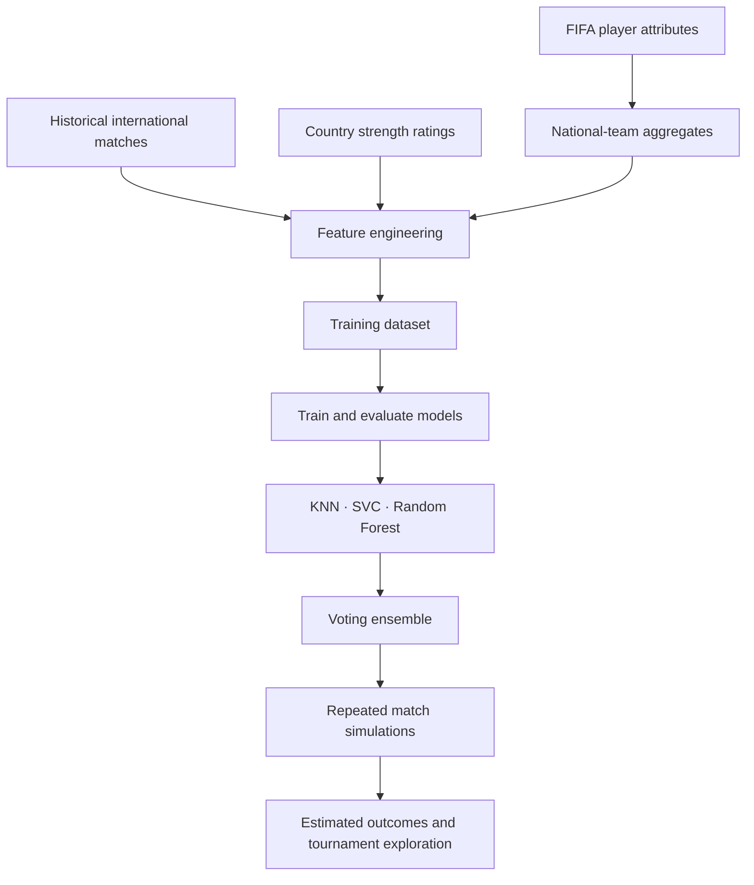

# ⚽ FIFA World Cup 2022 | Data Analysis & Match Predictions

<p align="center">
  <strong>Exploring whether international match history, FIFA player attributes and team ratings can help model football outcomes.</strong>
</p>

<p align="center">
  
  
  
  
  
</p>

---

## The idea

What if we combined national-team strength, player attributes and historical international results to explore the possible outcomes of the FIFA World Cup Qatar 2022?

This project brings together football data preparation, exploratory analysis, feature engineering and machine learning. It experiments with several classifiers, combines model predictions, and uses repeated match simulations to explore tournament outcomes.

**This is a retrospective research and portfolio project.** It is not betting advice, does not guarantee match outcomes, and should not be interpreted as a claim that the tournament was predicted perfectly.

## At a glance

| Area | Project approach |
|---|---|
| Data | International match results, FIFA player attributes and country ratings |
| Feature engineering | Aggregated player and national-team attributes |
| Models | K-Nearest Neighbours, Support Vector Classifier and Random Forest |
| Ensemble | Voting Classifier |
| Simulation | Repeated stochastic head-to-head match simulations |
| Main artifact | End-to-end Jupyter notebook |

## What you'll find here

- **Football data exploration** — inspect international match history and player/team data.
- **Team feature engineering** — aggregate player ratings and mentality attributes by nationality.
- **Model experiments** — train and compare KNN, SVC and Random Forest classifiers.
- **Ensemble learning** — combine selected estimators using a Voting Classifier.
- **Tournament simulation** — repeat match predictions with random variation to explore possible outcomes.
- **Research documentation** — supporting write-up, presentation, data notes and model notes.

## How the workflow fits together



## Repository map

```text
FIFA-WC-2022-Analysis/
├── README.md
├── GITHUB_SETUP.md
├── CONTRIBUTING.md
├── requirements.txt
├── .gitignore
│
├── notebooks/
│   └── FIFA_WC_2022_Analysis_and_Predictions.ipynb
│
├── data/
│   ├── README.md
│   └── raw/
│       ├── country_rating.csv
│       ├── matches.csv
│       └── players_*.csv
│
├── scripts/
│   └── fifaindex_crawler_legacy.py
│
├── reports/
│   ├── FIFA22PredictionModel-WriteUp.docx
│   └── FIFAPrediction.pptm
│
├── assets/
│   └── images/
│
└── docs/
    ├── DATA_DICTIONARY.md
    ├── MODEL_NOTES.md
    └── PROJECT_STRUCTURE.md
```

## Run it locally

### 1. Clone the repository

```bash
git clone https://github.com/<your-username>/FIFA-WC-2022-Analysis.git
cd FIFA-WC-2022-Analysis
```

### 2. Create a virtual environment

**Windows PowerShell**
```powershell
python -m venv .venv
.venv\Scripts\Activate.ps1
```

**macOS / Linux**
```bash
python3 -m venv .venv
source .venv/bin/activate
```

### 3. Install dependencies

```bash
python -m pip install --upgrade pip
pip install -r requirements.txt
```

### 4. Start Jupyter

```bash
jupyter notebook
```

Open `notebooks/FIFA_WC_2022_Analysis_and_Predictions.ipynb` and execute the notebook cells in order.

> **Path note:** Notebook data paths are relative to the notebook location and point to `../data/raw/`. If you execute code from a different working directory, adjust the paths accordingly.

## Data sources and attribution

The supplied project write-up attributes player and international match datasets to Kaggle and country ratings to FIFA Index. The original archive did not include exact dataset URLs, versions, download dates or licence details.

The included CSV files are retained from the supplied project archive. **Before publishing this repository publicly, verify each dataset's licence and attribution requirements.** If redistribution is not permitted, remove the relevant raw files from the public repository and document how users can obtain them from the original source.

See [`data/README.md`](data/README.md) and [`docs/DATA_DICTIONARY.md`](docs/DATA_DICTIONARY.md).

## Models and evaluation

| Model | Purpose |
|---|---|
| K-Nearest Neighbours | Distance-based classification baseline |
| Support Vector Classifier | Margin-based classification |
| Random Forest | Tree ensemble and feature exploration |
| Voting Classifier | Combines selected base estimators |

The notebook explores accuracy, classification reports and confusion matrices. Review the notebook for the exact split, tuning process, selected features and reported results.

## Limitations to keep in mind

- Player ratings and historical results are only proxies for team performance.
- Aggregating player attributes by nationality hides line-ups, tactics, injuries and player availability.
- Match outcomes depend on venue, tournament context, opponent strength and many other factors.
- A home/away training target may not transfer cleanly to neutral-site tournament matches.
- Random noise is a simplifying simulation assumption, not automatically a calibrated probability model.
- Draws, extra time and penalty shoot-outs need explicit handling in knockout simulations.
- Results should be interpreted as exploratory model outputs, not reliable forecasts.

## Ideas for future development

- Add time-based validation to reduce temporal leakage.
- Include neutral venue, recent form, rest days and tournament-stage features.
- Compare against Elo ratings and simple baseline models.
- Model scorelines or draw probabilities explicitly.
- Add calibration metrics such as Brier score and log loss.
- Refactor reusable logic into a tested `src/` package.
- Build an interactive Streamlit dashboard for match simulations.

## Project files

- [Analysis notebook](notebooks/FIFA_WC_2022_Analysis_and_Predictions.ipynb)
- [Original project write-up](reports/FIFA22PredictionModel-WriteUp.docx)
- [Presentation](reports/FIFAPrediction.pptm)
- [Data documentation](data/README.md)
- [Data dictionary](docs/DATA_DICTIONARY.md)
- [Model notes](docs/MODEL_NOTES.md)
- [GitHub publishing checklist](GITHUB_SETUP.md)

## Contributing

Suggestions and improvements are welcome. Please read [CONTRIBUTING.md](CONTRIBUTING.md) before opening a pull request.

## License and reuse

No software or data licence was included in the supplied archive. Until the rights to the original code, datasets and assets are verified, this repository does not grant permission to reuse or redistribute them. See [GITHUB_SETUP.md](GITHUB_SETUP.md) before choosing a licence.

---

<p align="center">
  Built with Python, pandas, scikit-learn, Jupyter and a love of football ⚽
</p>
